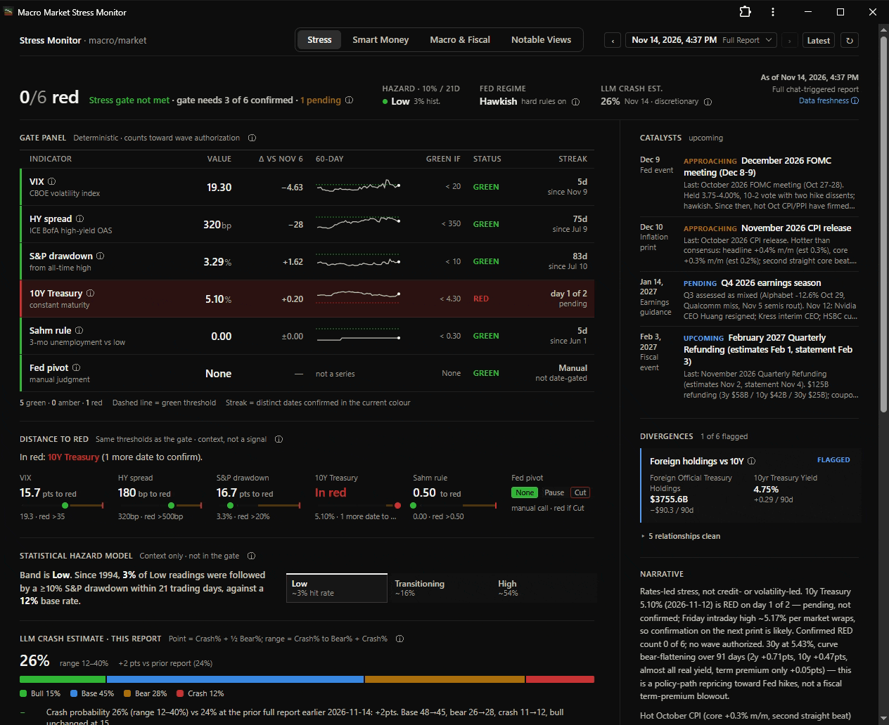

# Macro Market Stress Monitor

<p align="center">
  
</p>

<p align="center">
  <b><a href="https://marketstress.org/">Live dashboard →</a></b> · free, no sign-up, updated daily
</p>

> **Not investment advice.** This is a personal, educational project. The
> dashboard's bands, stress gate and crash probability apply the author's own
> rules to public data; they are not recommendations to buy or sell anything,
> and the data can be delayed, revised or wrong. The code is shared as-is,
> with no warranty.

A market-stress monitoring system. It started as a giant static prompt (numbers
hand-pasted into an LLM chat on every run) and became a small pipeline: daily
data ingestion, a deterministic rule engine, a local MCP server for Claude
Desktop, and two reporting sites.

The core idea: **numeric classification is never an LLM's job.** Every
threshold, band and RED/AMBER/GREEN colour is computed by plain code from real
market data. The LLM does the qualitative work (reading news, judging Fed
communication, writing the narrative) and always reports what the code
already decided; it never re-derives it.

## What's deterministic and what's judgment

This is a stress-monitoring and discretionary deployment dashboard, **not a
calibrated crash-probability model**. Both reporting pages say so.

| Output | How it's produced | Validated? |
|---|---|---|
| 6-indicator panel, bands, confirmation windows, stress gate | Code (`rule_engine/`), thresholds in `config/monitoring.yaml` | Deterministic and reproducible |
| Deployment waves | Code (`mcp_server/`), triggers in a private local policy file | Deterministic. The pathways were replayed against every ≥20% S&P drawdown since 1993, but the thresholds are a personal choice, not an optimised fit |
| Hazard model: P(10%+ drawdown within ~21 trading days) | Offline-fit logistic regression, run daily in code | Replayed in-sample: it ranks risk better than drawdown alone, but its raw percentages ran about 2× too high, so the dashboard shows measured historical hit rates instead |
| Crash probability | Derived by formula from an LLM-committed bull/base/bear/crash scenario split | No: it's a considered opinion, not a statistic |
| Crash-type diagnosis, Fed classification | LLM judgment informed by the panel and web research | No |

The full write-up is in
[`reference_docs/rules/crash-check-rules.md`](reference_docs/rules/crash-check-rules.md)
("What this system actually is") and
[`reference_docs/hazard-model-explained.md`](reference_docs/hazard-model-explained.md).

## Architecture

```
FRED · Yahoo · Treasury · EIA · CBOE · CFTC · FINRA · SEC EDGAR
State Street · Caldara-Iacoviello GPR · Polymarket · Massive
        │
        ▼  GitHub Actions, 10am ET Mon–Sat + 6pm ET Mon–Fri (SEC 13F: manual, quarterly)
┌────────────────┐     ┌───────────────────────┐     ┌────────────────┐
│ ingestion/      │────▶│ Supabase              │◀───▶│ rule_engine/   │
│ fetch, normalise│     │ public: market data,  │     │ panel, stress  │
│ plausibility    │     │   rule output         │     │ gate, hazard   │
│ guard           │     │ private: snapshots,   │     │ model, ntfy    │
└────────────────┘     │   watchlist prices    │     └────────────────┘
                        │ No dollar figures.    │
                        └──────────┬────────────┘
          ┌────────────────────────┼─────────────────────────┐
          ▼                        ▼                          ▼
┌──────────────────┐   ┌──────────────────────┐   ┌──────────────────────┐
│ mcp_server/       │   │ dashboard_site/       │   │ full_report_site/     │
│ local stdio, 21   │   │ public, static,       │   │ private, Cloudflare   │
│ tools. Reads      │   │ public market data    │   │ Access, server-side   │
│ local_state/ and  │   │ only                  │   │ Pages Function        │
│ evaluates waves   │   │                       │   │                       │
└────────┬─────────┘   └──────────────────────┘   └──────────────────────┘
         │
   Claude: "run crash check" (scheduled weekdays, 6:30pm ET, after the close)
   and "run portfolio review" (on demand)
```

| Component | What it does |
|---|---|
| [`ingestion/`](ingestion/) | Pulls each source into Supabase. A plausibility guard quarantines implausible values before they're written. A backfill script loads each series' full history. No LLM and no classification logic. |
| [`rule_engine/`](rule_engine/) | Pure functions: the 6-indicator panel, confirmation windows, the stress gate, cross-indicator divergence flags and the hazard model. Writes `crash_checks`, and sends an ntfy.sh push when the confirmed-RED count rises to 2 or more. Vitest suite. |
| [`mcp_server/`](mcp_server/) | Local stdio MCP server for Claude Desktop. 21 tools: workflow instructions, market state, context indicators, rules lookup, portfolio drift, watchlist, wave evaluation, deployment planning and fire drill, fund-filing watch, and write/persist tools. Runs locally because it's the only component that reads personal data. `node:test` suite. |
| [`dashboard_site/`](dashboard_site/) | Public static site (Cloudflare Pages, no build step). Reads only public market data with the anon key. |
| [`full_report_site/`](full_report_site/) | Private page behind Cloudflare Access: wave status, personal triggers, the watchlist with insider activity, crash-type diagnosis and the portfolio review. Rendered server-side, so no credential reaches the browser. |
| [`config/`](config/) | `monitoring.yaml`: the public panel bands, confirmation days, stress gate and push-alert count, read by both `rule_engine` and `mcp_server`. |
| [`supabase/migrations/`](supabase/migrations/) | Schema and row-level-security history. |

## The 6-indicator panel and the stress gate

The panel tracks VIX, HY credit spreads, S&P drawdown from its all-time high,
the 10-year Treasury yield, the Sahm Rule and a Fed-pivot signal. A RED
reading only counts once it holds across two or more distinct ingestion dates,
so a single noisy print can't trigger anything. The **stress gate** is met
when 3 or more of the 6 are confirmed RED. All of these thresholds live in
[`config/monitoring.yaml`](config/monitoring.yaml).

**Wave deployment** is a staged, three-tranche plan for deploying a cash
reserve. A wave needs two things at once:

1. **Its own trigger:** S&P drawdown from the all-time high plus a VIX level
   (same day), or a separate "slow-bear" pathway (deep drawdown plus a fresh
   one-year low, confirmed on two dates) for grinding, low-volatility bears
   like 2000–02 and 2022, which the drawdown+VIX pathway missed in
   backtesting.
2. **The stress gate.**

Trigger levels and the percentage split of each wave are personal policy, so
they live in a gitignored local file, not in this repo, and waves are
evaluated on the local machine from public inputs the rule engine publishes
(drawdown, VIX, days since a one-year low). Deployment is cumulative and
execution-aware: a fast crash that skips straight to Wave 3 returns every
not-yet-executed wave, and executed waves are tracked locally so they're
never proposed twice.

## Beyond the panel (context only, never gates)

- **Contextual indicators:** financial-conditions and stress indices,
  breakevens, jobless claims, IG spreads, the yield curve and the NY Fed's
  recession-probability model, the SOFR−IORB repo-stress spread, MOVE bond
  volatility, Treasury auction quality, copper, recent-grad unemployment and
  more.
- **Distance to RED:** how far each panel indicator is from its RED band.
- **Divergence detection:** pairs that normally move together (IG vs HY
  spreads, initial vs continuing claims, VIX vs HY, gold vs silver), flagged
  when they decouple.
- **Positioning and flows:** CFTC Commitments of Traders, CBOE put/call and
  FINRA margin debt as historical percentiles; sector rotation; 13F
  institutional net buying by sector.
- **Fiscal dominance checklist:** Taylor-rule gap, primary balance, net
  interest as a share of GDP, and the gold/real-yield relationship.
- **Event-conditional scenarios** for scheduled events such as FOMC
  meetings.

## The public dashboard

Four tabs, all read-only:

- **Stress:** the panel, the stress gate, distance to RED, the hazard model,
  the LLM crash-estimate history, upcoming market events, and indicator
  history charts with their bands.
- **Smart Money:** market positioning, sector rotation and institutional
  13F tilt.
- **Macro & Fiscal:** the fiscal dominance checklist, contextual
  indicators, the yield curve and rates decomposition.
- **Notable Views:** what well-known macro voices are saying, set against
  today's data. Short attributed paraphrases with links and dates, reviewed
  by hand before publishing.

You can browse past reports with a calendar picker, check each source's
freshness, and install the dashboard as a home-screen app (PWA).

## Two chat workflows (Claude Desktop)

- **"Run crash check"** runs daily as a Claude Desktop scheduled task. It
  confirms ingestion actually ran, pulls the panel and context, and commits
  to a scenario distribution **before** it can see the previous report's
  number. That anti-anchoring rule is enforced by tool order: no tool used in
  the first six steps exposes a prior probability. It then does the
  qualitative research, persists the result (`write_snapshot` for the public
  row, `write_full_report` for the private page) and ends with a plain-text
  summary. Steps:
  [`project-instructions.md`](reference_docs/rules/project-instructions.md).
- **"Run portfolio review"** runs on demand. It covers portfolio drift
  against targets, watchlist status, a deployment fire drill, fund-filing
  checks and a re-underwrite of each watchlist thesis. It's rendered from
  [`portfolio-review-template.html`](reference_docs/rules/portfolio-review-template.html)
  and merged into the private Full Report page.

## How changes get made

- **Every new signal must earn its place.** A new flag is backtested for a
  base rate and a forward edge before it ships, and ideas that fail stay
  documented with their evidence so they aren't re-proposed. Examples: a
  MOVE-vs-VIX divergence flag, a BDC-ETF private-credit proxy and
  high-frequency positioning signals were all rejected. See "Investigated
  and rejected" in the rules doc and
  [`BUILD_SPEC_crash_check_enhancements.md`](reference_docs/BUILD_SPEC_crash_check_enhancements.md).
- **Low-signal features get cut.** A discretionary "Risk Radar" score was
  retired, and later deleted, after its readings swung run to run on
  unchanged data.
- **Self-corrections are published.** The hazard model's overstated
  probabilities were relabeled rather than hidden. External reviews and
  their outcomes are in
  [`architecture-summary-for-external-review.md`](reference_docs/architecture-summary-for-external-review.md).
- **Refactors are checked for identical behaviour.** Moving thresholds into
  config files and wave evaluation onto the local machine was verified by
  diffing old and new code over every input combination and the full real
  history before switching over.

## Security model: public engine, private policy

Personal financial data never reaches a cloud service, and personal policy
never reaches the public repo or the public tables.

- **Three kinds of configuration.**
  - Public monitoring thresholds: [`config/monitoring.yaml`](config/monitoring.yaml).
  - Personal policy, local and gitignored: `local_state/policy.yaml` (wave
    triggers, wave and crash-type splits, hard rules, private terms) and
    `local_state/personal-rules.md` (the personal sections of the rules doc,
    merged in by the `get_rules` tool).
  - Dollar data, local and gitignored: balances, cash reserve, position
    sizing, executed waves, the exchange log.

  The repo tracks only `*.example.yaml` templates with illustrative numbers.
- **Two access tiers in Supabase.** `crash_checks` and `data_points` are
  readable with the public anon key, which is how the dashboard works; they
  hold market data, rule output and market-event triggers only. Everything
  personal, including the private report snapshots, watchlist ticker prices
  (`private_data_points`), the watchlist and its insider activity, is
  readable only with the server-side key that the local MCP server and the
  Access-gated Pages Function hold.
- **Guardrails in code, not just instructions.** Every write path that
  persists free text checks it against the real local portfolio and throws
  on any dollar figure. `write_snapshot` also refuses public text containing
  any of the policy's private terms (account names, "watchlist") and keeps
  only market-event triggers on the public row.
- **Dollar amounts are computed at read time.** The policy stores wave
  splits as percentages of the cash reserve; the MCP server applies them to
  the local balance, and the result stays in chat.

## Repo structure

```
ingestion/            data sources → Supabase, plausibility-guarded
rule_engine/          deterministic panel, stress gate, hazard model, push alert
mcp_server/           local MCP tools for Claude Desktop (21 tools), wave evaluation
dashboard_site/       public dashboard (static)
full_report_site/     private Full Report page (Cloudflare Pages Function)
config/               public monitoring thresholds
reference_docs/rules/ rules doc, chat instructions, review template
reference_docs/       hazard-model explainer, external-review summary, enhancement specs
supabase/migrations/  schema + row-level security
local_state/          *.example.yaml templates; real files are gitignored
.github/workflows/    daily ingest + classify, backfill, SEC 13F
```

## Setup

**Run it yourself at your own risk.** This is one person's working setup,
not a packaged product. You'll need your own Supabase project, Cloudflare
Pages, GitHub Actions, several free API keys and Claude Desktop. If you only
want the signals, use the
[live dashboard](https://marketstress.org/).

Requires Node 22+. Each of `ingestion/`, `rule_engine/` and `mcp_server/` is
an independent package (`npm ci` inside each; no root workspace) with a
`.env.example` to copy to `.env`:

- `SUPABASE_URL`, `SUPABASE_SERVICE_ROLE_KEY`: from your Supabase project
- `FRED_API_KEY` (free, fred.stlouisfed.org) and `EIA_API_KEY` (free,
  eia.gov/opendata)
- `MASSIVE_API_KEY`: free tier at massive.com, for watchlist prices
- `SEC_EDGAR_CONTACT_EMAIL`: SEC requires a contact address in automated
  requests
- `POLYMARKET_SLUGS` (optional): Polymarket markets to track
- `NTFY_TOPIC` (optional): a random, unguessable ntfy.sh topic for push
  alerts

Then:

1. Copy each `local_state/*.example.yaml` to the same name without
   `.example` and fill in your own values, starting with `policy.yaml`
   (your wave triggers and splits) and `portfolio.yaml`. Optionally add a
   `local_state/personal-rules.md` with your own versions of the rules
   doc's personal sections, under the same headings.
2. Tune [`config/monitoring.yaml`](config/monitoring.yaml) if you want
   different bands or a different stress gate.
3. Apply `supabase/migrations/` in order (SQL editor or Supabase CLI).
4. Add the same values as GitHub Actions secrets for
   `.github/workflows/ingest.yml`. Run `backfill.yml` once to load history.
5. Claude Desktop: merge
   [`mcp_server/claude_desktop_config.example.json`](mcp_server/claude_desktop_config.example.json)
   into your config (the MCP server needs `PORTFOLIO_PATH` and
   `WAVE_DEPLOYMENT_STATE_PATH`; the other local files default to sitting
   next to `PORTFOLIO_PATH`). Create a Claude Desktop project and set its
   instructions to one line: *"Before anything else, call the crash-check
   `get_instructions` tool and follow what it returns."* Attach nothing as
   project knowledge: the MCP server serves the workflow instructions and
   review template (`get_instructions`) and the rules doc (`get_rules`)
   straight from this working tree.
6. `dashboard_site/`: a Cloudflare Pages project with no build step. Swap
   in your own Supabase URL and anon key.
7. `full_report_site/`: a second Pages project behind Cloudflare Access.
   See [`full_report_site/README.md`](full_report_site/README.md).

Tests: `npm test` in `rule_engine/` (Vitest) and `mcp_server/` (`node:test`);
`npm run typecheck` in all three packages. Tests use the example policy,
never your real one.

## Known gaps

See [`BACKLOG.md`](BACKLOG.md): open items, deliberately deferred rather
than forgotten.

## Data sources

Each data source (FRED and the series' original providers, Treasury, EIA,
CBOE, CFTC, FINRA, SEC EDGAR, State Street, Polymarket, Yahoo Finance,
Massive) keeps its own terms, and you're responsible for complying with them
when you run the code with your own keys.

## Project status

A personal project with a single maintainer, shared as-is. It runs daily and
is actively used, but there's no support commitment: questions and
suggestions are welcome, and responses aren't guaranteed. No open-source
license has been chosen yet, so all rights are reserved for now.
