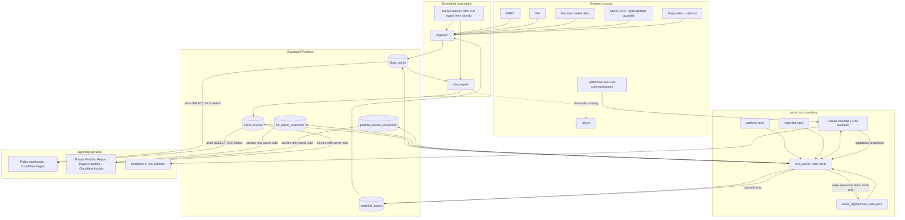

# Macro Market Stress Monitor — Architecture & Rules Summary (for external AI review)

Last reviewed against the repository: 2026-10-29.

This is a self-contained briefing for a fresh model/chat with no other context on this
project. It covers system architecture, data flow, security model, prior external-review
findings and their current status, and points to the current rules (thresholds/bands/formulas) that govern the
crash-detection and wave-deployment logic. Paste this document, plus the rules doc, as
context when asking another model to analyze or propose changes to the system — nothing
here is sensitive (no dollar figures, no credentials, no personal account data).

**This document supersedes the separate `architecture-review.md`** (a prior external
review, dated 2026-08-14) — its findings are folded into the "Prior architecture review:
findings and current status" section below rather than kept as a standalone file, so
there's one place to read instead of two overlapping ones.

## What this system is

A market-crash-monitoring pipeline that replaced a giant hand-updated prompt with a
small, deterministic pipeline: live data ingestion → a rule engine that classifies
market conditions → a local MCP server exposing tools to Claude Desktop → two
reporting surfaces (a rich on-demand chat report, and two public/private web
dashboards).

**Core design philosophy: numeric classification is never an LLM's job** — for the parts
that are actually mechanical. Every threshold, band, RED/AMBER/GREEN color, confirmation
window, and wave trigger is computed by plain deterministic code from real market data —
never inferred, estimated, or "reasonably judged" by an LLM at report time.

**This is not true of everything the system produces, and the system now says so
explicitly** (added 2026-08-15, after an external investment-model review flagged the gap
between this framing and reality — see below). Crash probability, crash-type diagnosis,
scenario distribution, and the Warsh Fed classification are LLM/human qualitative
judgment, not rule-engine output — informed by the deterministic panel and web research,
but with no defined forecast horizon, no historical labels, no out-of-sample validation,
and no reliability testing behind them. **This system is best described as a
stress-monitoring and discretionary deployment dashboard, not a calibrated
crash-probability model** — treat the displayed probability as a considered opinion, not
a statistic, and do not treat the three-wave deployment thresholds as empirically
optimal.

## Architecture

### Layers

| Layer | What it does | Where |
|---|---|---|
| **Rules** | Static thresholds, bands, wave-deployment percentages, crash-type diagnosis criteria | `reference_docs/rules/crash-check-rules.md` (full text reproduced below) |
| **Ingestion** | Pulls FRED/EIA macro series (full available history since 2026-08-15, not a rolling 5yr window) + Massive.com watchlist ticker prices daily | `ingestion/` (GitHub Action, `.github/workflows/ingest.yml`, 10am ET Mon-Sat + 6pm ET Mon-Fri) |
| **Rule engine** | Computes the 6-indicator RED/AMBER/GREEN panel, confirmation windows, wave authorization (relative-drawdown triggers since 2026-08-15), cross-indicator divergence detection, threshold-crossing push notifications — pure functions, no LLM | `rule_engine/` |
| **MCP server** | Local stdio server exposing tools to Claude Desktop (indicator panel, portfolio drift, watchlist status, deployment plan, 5 write/persistence tools, data-freshness check) | `mcp_server/` |
| **Reporting** | Chat-rendered HTML reports (2 templates), a public historical dashboard, and a private "Private Portfolio Report" page merging crash-check + portfolio-review content | `reference_docs/rules/*.html`, `dashboard_site/`, `full_report_site/` |

## The 6-indicator panel (the deterministic gate)

VIX, HY credit spreads, S&P drawdown from ATH, 10yr Treasury yield, the Sahm Rule, and
Fed pivot signal. Wave deployment (a staged, 3-tranche dry-powder deployment plan)
authorizes only when 3+ are simultaneously RED, **and** each RED reading has held
across 2+ distinct daily ingestion dates (not just repeated same-day checks) — see
Signal Tiering below. Full thresholds and wave math are in the rules doc reproduced
in full below.

## Wave deployment & authorization (fixed 2026-08-15)

An architecture review (2026-08-14) and an investment-model review (independently)
both identified the same material gap: `get_deployment_plan` checked only `wave_active`
(the S&P-drawdown/VIX price trigger) and never `wave_authorized` (the confirmed
3-of-6-RED gate) — a single unconfirmed volatile day could surface a real dollar
deployment plan. Three fixes shipped together:

1. **Both gates now required.** `get_deployment_plan` denies with an explicit
   "observed, not yet authorized" message if `wave_active` is set but `wave_authorized`
   is false — closing the bypass. This makes authorization *stricter* than before, not
   looser (see "still open" below re: whether that direction is even correct).
2. **Relative drawdown thresholds, not fixed S&P levels.** `activeWave()` (`rule_engine/
   src/rules.ts`) now triggers on ATH-relative drawdown % (deeper for each wave)
   instead of fixed nominal S&P levels — a fixed level
   decays in meaning as the index's all-time high rises over time; a drawdown
   percentage doesn't.
3. **Cumulative, execution-aware deployment.** Previously, a market move deep and fast
   enough to satisfy Wave 3's condition without Wave 1/2 ever separately confirming
   would return *only* Wave 3's fund allocation, silently skipping the diversification
   Wave 1/2 were meant to add. `get_deployment_plan` now returns the combined breakdown
   for every not-yet-executed wave up to and including the current one. A new local file
   (`local_state/wave_deployment_state.yaml`, same trust boundary as `portfolio.yaml`)
   and MCP tool (`record_wave_deployment`) track which waves have actually been
   executed, so a wave already acted on isn't re-proposed.

**Still open**: whether the joint drawdown-AND-VIX construction and the "3-of-6 RED"
authorization rule are themselves well-calibrated remains unresolved — a real backtest
against 2020 data found the current thresholds already miss real episodes in both
directions (Wave 3 never fired in 2020 despite VIX hitting 82; Wave 2 never fired in the
2022 grinding bear market). Requiring `wave_authorized` in addition to the price/VIX
trigger makes the system stricter, which cuts against that finding rather than resolving
it. Recalibrating the actual threshold values needs real backtested evidence — deferred
to future hazard-model work (see below), not guessed at.

## Cross-indicator divergence detection (documented in the rules doc since 2026-08-16)

Four pairs of normally-correlated series are checked daily for a 7-day-delta
split large enough to suggest they've decoupled — a relationship-level signal
the 6-indicator panel's individual bands can't see on their own:

- **IG vs. HY credit spreads** — IG widening while HY holds flat can read as
  an early quality-flight signal ahead of the gating HY spread moving.
- **Initial vs. continuing jobless claims** — continuing claims rising while
  initial claims stay flat suggests laid-off workers are taking longer to
  find new jobs (labor-market cooling, distinct from a fresh layoff wave).
- **VIX vs. HY credit spreads** — the one pair where a flagged divergence is
  the *reassuring* reading, not the concerning one: VIX spiking without HY
  confirming reads as equity-specific noise, not stress broad enough to move
  credit markets. Consumers of this flag must not treat "diverging" as
  uniformly bad across all four pairs.
- **HY widening vs. VIX calm** *(added 2026-08-16)* — the reverse of the pair
  above, and previously the more concerning missing direction: credit stress
  surfacing before equity vol does (credit often leads equity). Thresholds
  deliberately reuse the VIX-vs-HY pair's own two constants (5bps, 3pts),
  flipped, rather than a fresh unbacktested number.

Computed once daily inside `rule_engine`'s `classify()`, persisted to
`crash_checks.divergence_flags` (each entry carries both series' current
value and 7-day delta, not just a boolean) — `mcp_server`'s
`get_context_indicators` and `dashboard_site`'s "Signal Relationships" card
both read that one persisted value rather than each computing their own copy,
consistent with the Rule Engine Output Contract below. Thresholds are a first
cut, not backtested/calibrated. **Known data limitation**: the two credit-spread
series feeding 3 of these 4 pairs only have real history back to
2023-07-11/2023-07-17 in this database (not the 1996 inception commonly cited
for these FRED series — verified, not an ingestion bug), meaningfully limiting
how far back any future calibration of these thresholds can be checked. Not
part of the 3-of-6 wave-authorization gate — informational only, same tier as
the other contextual indicators. Still deliberately deferred: rolling-
correlation infrastructure, and a regime-dependent 10yr-Treasury-vs-equities
pair (needs the regime concept from the future hazard-model work to mean
anything, not a naive non-regime-aware version now).

## Stage 4 recovery-transition detection (built 2026-08-16)

The rules doc's "Recovery Signal and 6-Month Transition" section was pure
prose with zero corresponding code until this date. Detection (not execution
tracking — see below) is now real:

- **Trough tracking**: a running minimum of the S&P level, tracked only while
  a drawdown episode is active (drawdown ≥10% from ATH — the same threshold
  the Crash Mode Protocol RED ALERT banner already uses, not a separately
  invented number). Resets to null once drawdown falls back under 10%.
- **VIX sustained below 25 for 3+ weeks**: reuses the same confirmation-streak
  mechanism as the 6-indicator panel (`computeConfirmation`, now generalized
  with an optional `requiredCount` parameter, default 2 — unchanged for the
  existing 5 indicators), applied here with `requiredCount: 15` (~3 weeks of
  trading days) as a separate `vix_recovery` confirmation entry.
- **Fed criterion** reuses `fed_pivot_signal === "CUT"` directly rather than a
  new field — the "within 2 meetings" recency qualifier is explicitly *not*
  independently tracked, same honesty-first treatment as every other
  manual/LLM-judged field in this system.
- `recovery_confirmed` is true once all three criteria hold simultaneously,
  and persists as a historical fact about the most recent episode until a
  *new* episode begins.

**Still manual**: the month-by-month glide-path execution tracking (which
step you're actually on) has no equivalent of `wave_deployment_state.yaml`/
`record_wave_deployment` yet — `recovery_confirmed` tells you *whether* to
start the table, nothing tracks *where* in it you are. Deliberately deferred
as a smaller follow-up once detection was proven live.

## Security model — split storage (why this matters for any rule changes)

- **Supabase** holds macro/market data only — VIX, CPI, wave status, indicator
  colors, crash probability, watchlist ticker prices/targets, and crash-type
  diagnosis narrative and Portfolio Opportunity Review content (drift %, ticker
  thesis, risk-radar scores). **No dollar figures, no account balances, ever** —
  enforced in code (`findLeakedDollarFigures()`), not just by prompt instruction:
  every write path that persists free text cross-references the real portfolio
  file's dollar figures and throws if any appear, rather than trusting the model
  to have followed a "don't include $" rule correctly every time.
- **`local_state/`** (gitignored, never committed, never leaves the machine) holds
  the real portfolio file — account balances, dry powder, allocation targets —
  the watchlist's position-sizing (`max_position_usd`, which *never*
  reaches Supabase even though everything else about the watchlist now does), and
  (since 2026-08-15) which wave-deployment tranches have actually been executed
  (`wave_deployment_state.yaml`) — action state tied to real trades, same trust
  boundary as the rest of this directory.
- **The MCP server runs locally via stdio**, not as a hosted service — it's the
  one component that touches `local_state/`.
- Wave-deployment amounts in the rules doc are percentages of "dry powder," never
  dollar figures — the MCP server combines the percentage with the real, local-only
  balance at read time, and that computation's output is chat-only, never
  persisted.
- The private "Private Portfolio Report" page (`full_report_site/`, renamed
  from "Full Report" 2026-08-17 — the old name collided with `dashboard_site`'s
  own unrelated "Full Report" row-type label) is gated by Cloudflare Access
  (email one-time-PIN, plus a GitHub OAuth identity provider added 2026-08-16
  as a lower-friction second option) *and* reads Supabase server-side with a
  `service_role` key that's never shipped to the browser — closing the
  access-control gap by design rather than relying on Access alone (a plain
  client-embedded anon key with broad SELECT would bypass Access entirely if it
  existed).

## The five MCP write/persistence tools

1. `write_snapshot` — persists the qualitative crash-check synthesis (probability,
   scenario distribution, narrative notes, and — since 2026-08-27 — the same
   structured `delta_log` already rendered in the chat HTML artifact's colored
   +/- list, previously only ever rendered live and never persisted) to
   `crash_checks`. Fixed 2026-08-16:
   previously, changing `fed_pivot_signal` here (e.g. NONE→CUT) updated
   `fed_pivot_color` but left `red_count`/`confirmed_red_count`/`wave_authorized`
   stale, carried forward verbatim — now recomputed from the other 5
   carried-forward colors plus the new fed-pivot color, mirroring `classify.ts`'s
   own formula. `confirmation_state` itself (the per-indicator streaks) stays
   untouched — only the aggregate counts derived from it refresh.
2. `write_full_report` — persists watchlist status (recomputed server-side from
   live prices, not trusted from the caller), crash-type diagnosis, and
   qualitative-only portfolio context to `full_report_snapshots`.
3. `write_watchlist` — full-replacement update of the watchlist
   (targets, thesis, position sizing locally; symbols only synced to Supabase).
4. `write_portfolio_review` — persists a Portfolio Opportunity Review's verdict,
   summary, macro cross-reference, per-ticker thesis re-underwrite, and risk-radar
   scores to `portfolio_review_snapshots`; portfolio drift is recomputed
   server-side, not trusted from the caller.
5. `record_wave_deployment` *(added 2026-08-15)* — marks a wave as actually executed
   (local-only, `wave_deployment_state.yaml`) after real trades are placed, so
   `get_deployment_plan` stops re-proposing it. Deliberately separate from the
   read-only `get_deployment_plan` call — computing a plan never has side effects.

All five run the dollar-figure guardrail against every free-text field before
writing (tools 1–4; `record_wave_deployment`'s inputs carry no free text).

## Anti-anchoring design (crash-check workflow ordering)

The daily "run crash check" workflow deliberately avoids showing the model any
prior probability/narrative until *after* it commits to this run's estimate — steps
are ordered so the indicator panel, contextual macro data, and portfolio snapshot
are read first, the model commits to a probability + scenario distribution using
only that data, and *only then* does it fetch the prior report's stored probability
(to build a delta-log/framing comparison, never to revise the number already
committed to). This exists because an earlier version let the model see its own
prior narrative before forming a new judgment, which produced anchoring instead of
independent daily assessment.

## Signal confirmation (avoiding single-noisy-day false triggers)

A RED reading on any of the 6 core indicators only counts toward wave authorization
once it has held across **2 or more distinct daily ingestion dates** — not just
repeated intraday checks against the same day's already-ingested value. This closes
an asymmetry where the original design required VIX sustained below 25 for 3 weeks
to declare recovery, but required zero persistence at all to authorize a real-money
deployment. The rule engine tracks this via a per-indicator streak counter
(`confirmation_state` jsonb column, `confirmed_red_count` derived from it) —
`wave_authorized` gates on the *confirmed* count, not the raw same-day count. The
same mechanism (`computeConfirmation()`) was generalized 2026-08-16 with an
optional `requiredCount` parameter (default 2, unchanged for these 5 indicators)
so the "VIX sustained below 25 for 3 weeks" side of that asymmetry could finally
be implemented too, not just cited as the historical justification — see "Stage 4
recovery-transition detection" above.

**2026-08-15 historical check**: an investment-model review argued this 2-day rule
creates false negatives in fast, event-driven crashes (citing Feb–Mar 2020). Queried
real `data_points` history rather than assuming: VIX confirmed RED by 2020-02-28,
three-plus weeks before the actual bottom; the S&P drawdown band confirmed RED by
2020-03-17, six days before the bottom (2020-03-23). On the two indicators verifiable
against current data, confirmation cleared with real runway to spare — not obviously
the dominant source of lag in this one episode. Not conclusive (HY spread data doesn't
go back that far in this database, and Fed pivot's manual judgment is a wildcard), and
no rule was changed on the strength of one partially-verifiable episode — see the full
finding in the rules doc below.

## Data-freshness guardrail

Before trusting the indicator panel as "today's data," the system compares the
latest `crash_checks` row's date (in America/New_York) against the expected
ingestion date (ingestion runs Monday-Saturday, so a Sunday check expects Saturday's run), and stops
with an explicit warning rather than silently analyzing stale data if ingestion
hasn't run yet. This exists because GitHub Actions' cron scheduler has been
observed firing up to ~60 minutes late in this project's real run history, so naive
fixed-offset scheduling (e.g. "run analysis 30 min after ingestion") isn't reliable
on its own.

## Threshold-crossing push notifications

A free ntfy.sh push notification fires the moment `confirmed_red_count` crosses
*up* into 2+ (not on every day it remains there) — runs inside the same daily
ingestion job, comparing today's row against the prior row to detect the
transition rather than just checking the current level.

---

# Prior architecture review: findings and current status

A full external architecture review (2026-08-14, `architecture-review.md`, since
folded into this document) scored the system 7.4/10 — "a thoughtfully layered,
single-user market-monitoring system" held back by "high-impact correctness risks
rather than implementation maturity." Its findings, and what's happened since:

## Strengths identified (still true, unchanged)

1. Security boundary matches data sensitivity — local financial state stays local;
   public/private data genuinely separated; private browsing never gets a service-role key.
2. Mechanical signals are reproducible — raw observations, derived states, and
   divergence results are persisted, not recomputed independently per view.
3. Safety controls are layered — required-source failure, plausibility quarantine,
   freshness checks, confirmation windows, idempotent writes, transition-only notification.
4. The LLM has a narrow, useful role — qualitative value added without letting it
   invent core numeric classifications.
5. The architecture is proportionate — serverless scheduling, Postgres, static public
   reporting, and a local stdio bridge, appropriate for a single-owner system.

## Fixed since the review

- **The deployment-authorization gap** ("the most consequential architectural finding" —
  `get_deployment_plan` deployed on `wave_active` alone, never checking `wave_authorized`)
  — fixed 2026-08-15, see "Wave deployment & authorization" above.
- **Fixed S&P wave-level decay** — wave triggers switched to ATH-relative drawdown %.
- **"Wave 3 fires first" / no execution-state problem** — fixed via cumulative
  deployment + `wave_deployment_state.yaml` + `record_wave_deployment`.
- **Specification/runtime honesty gap re: crash probability and crash type** — the
  rules doc previously claimed the rule engine owned the crash-probability score and
  crash-type triggers while a separate section admitted both are 100% LLM judgment; the
  contradiction is now resolved, and the doc states plainly what's deterministic vs.
  qualitative (see "What this system is" above, and "What this system actually is" in
  the rules doc below). The same caveat now appears next to every surfaced probability
  figure on the public dashboard and the private Portfolio Report — not just in the rules doc.
- **Missing-indicator gaps (partial)** — 5 new verified free FRED series added
  (`SOFR` for repo/liquidity stress, `DTWEXBGS` for the dollar-transmission leg,
  `NFCIRISK`/`NFCICREDIT` for bank-funding/credit-conditions stress, `DFII10` for the
  real-yield leg of equity valuation). A 6th candidate (`OECDLOLITOAASTSAM`, a global-PMI
  stand-in) was tried and dropped after verification showed it frozen since 2022-11 —
  removed rather than shipped with a misleading caveat.
- **"Never sell on the way down" liquidity/concentration/tax-status concern** — reviewed
  against the actual account schema; the two accounts it would plausibly apply to are
  already excluded from wave deployment by their own flags. No code change needed;
  documented in the rules doc so it doesn't get re-flagged as an open gap later.
- **`write_snapshot`'s stale-field inconsistency** (Fed-pivot judgment change not
  triggering a `red_count`/`confirmed_red_count`/`wave_authorized` recompute) —
  fixed 2026-08-16, see "The five MCP write/persistence tools" above. This was
  listed as a known-unfixed inconsistency in the original review; it no longer is.
- **Stage 4 recovery-transition tracking** — was "pure prose, zero code"; detection
  (trough tracking, VIX-sustained-25 window, the composite gate) is now built and
  verified live, 2026-08-16. Execution tracking (which month/step) is still manual
  — see "Stage 4 recovery-transition detection" above for the exact split.
- **Divergence detection's missing "HY widening without VIX confirming" direction**
  — added 2026-08-16 as the 4th pair. Rolling-correlation infrastructure and the
  regime-dependent 10yr-vs-equities pair remain deferred (see above).
- **A real bug found and fixed along the way, not from either original review**:
  `write_snapshot` was silently dropping `divergence_flags` on every full
  chat-triggered report (no DB default on that column), so the dashboard's
  "Signal Relationships" card vanished on exactly the report type most likely to
  be read closely, while working fine on bare automated refreshes. Fixed
  2026-08-16 by carrying the field forward like every other rule-engine-owned
  mechanical field.
- **Another one found the same way, 2026-08-27**: the chat report's colored
  +/- delta log was only ever rendered live, never persisted — the public
  dashboard could only show unstructured `notes` prose, and (more tellingly)
  `dashboard_site` already had `.delta-log`/`.sign` CSS sitting completely
  unused since before this was noticed. Fixed by adding an optional
  `delta_log` field to `write_snapshot` (both its TS signature and its
  separate Zod `inputSchema`, which would have silently stripped the field
  otherwise) and wiring up the dormant CSS with a new `renderDeltaLog()`.

## Still open

- **Rules are duplicated across prose (rules doc) and code (`rule_engine`, `mcp_server`,
  `dashboard_site` all independently re-encode the same thresholds/splits).** No shared
  executable rules package exists yet. Every change so far has been made by hand-editing
  each location in sync — works, but has no compile-time guarantee they stay in sync.
- **Qualitative state (crash probability, crash type, Warsh classification, trigger
  status) still lacks provenance/versioning.** Fields are copied forward from the prior
  `crash_checks` row rather than referencing an explicit source/effective/expiry model.
  (The specific Fed-pivot/red-count staleness inconsistency this originally also
  flagged is now fixed — see "Fixed since the review" above; the broader
  provenance/versioning gap is not.) Separately, trigger re-checking itself had the
  same class of problem at the *instructions* level, not code: `trigger_status` was
  being carried forward unchecked across reports even when the underlying condition
  had genuinely changed (found live 2026-08-17 — a rate-reset trigger stayed stuck on
  a stale note for 3 consecutive reports after the actual rate was updated locally).
  Fixed by making trigger re-verification an explicit required step in
  `project-instructions.md` rather than a passive "only if you happen to notice" one.
  A related but distinct staleness bug surfaced later (2026-08-26): the Fed-event and
  inflation-print triggers' *target date itself* (which FOMC meeting/CPI release is
  "current") had no rollover mechanism at all — a live report kept showing "July FOMC"
  after it should have advanced to September's meeting. That one got the deeper,
  code-level fix (`mcp_server/src/lib/economicCalendar.ts`, see the rules doc below)
  rather than another instructions-level nudge, since FOMC/CPI dates are publicly
  scheduled facts, not judgment calls — the same category of problem the rate-reset
  trigger already illustrated.
- **No rule-state/workflow contract test suite exists.** Verification for every change
  in this project so far has been `tsc --noEmit` plus manual/throwaway scripts — real,
  but not a durable regression suite for threshold boundaries, confirmation timing, or
  deployment-denial-before-authorization.
- **No ingestion run/per-series health record.** A dataset-freshness decision exists at
  the whole-run level (see "Data-freshness guardrail" above) but not per-series — a
  successful run can still contain stale weekly/monthly observations for some series.
- **Public dashboard's `crash_checks` history read is a flat `limit=1000`, unpaginated**
  — will silently truncate once history grows past that. `data_points` reads are already
  paginated; `crash_checks` is not.
- **The Private Portfolio Report's service-role key is broad and long-lived** in the
  Cloudflare Pages environment — not yet narrowed to a dedicated read-only role/function.
- **Stage 4 recovery-transition *execution* tracking** — detection is now built (see
  above); the month-by-month glide-path execution state (which step you're actually
  on) is still manual, no `wave_deployment_state.yaml`-equivalent exists for it yet.
- **The full hazard-probability model / regime detection / expected-utility deployment
  policy** the investment-model review called for (see below) — **v1 of the forecast
  layer shipped 2026-08-26** (see "Statistical Hazard Model" in the rules doc below):
  a walk-forward-validated, isotonic-calibrated logistic model for the 10%-drawdown
  target, hand-ported to TypeScript, live via `get_indicator_panel` and a dedicated
  dashboard card. Built via an offline Python research pipeline as originally planned,
  with real backtest data (dot-com/GFC/Dec-2018/COVID/2022). Still not started: regime
  detection, the expected-utility deployment-policy layer, and the companion
  20%-drawdown target (tested, explicitly shelved — its bootstrap CI couldn't be
  distinguished from a naive guess given only 4 usable real episodes). Two external,
  published, backtested recession-probability models (Chauvet-Piger via FRED, and the
  NY Fed's Estrella-Mishkin formula computed locally) were added 2026-08-17 as
  calibration cross-checks separately — they inform the narrative, they do not
  calibrate this system's own crash-probability estimate, and are a different thing
  from the hazard model itself.
- **Watchlist ticker selection** still has no documented "why this ticker"
  rationale beyond a one-line theme tag.
- **Divergence-detection remaining scope**: rolling-correlation infrastructure and a
  regime-dependent 10yr-vs-equities pair remain deliberately deferred, not started.

---

# Prior investment-model review: findings and current status

A separate CIO/quant-perspective review (`archive/investment-model-review.md`, since folded into
this document) disagreed with the system as a capital-allocation model — "a useful
dashboard of stress indicators, but not a calibrated crash-probability model or a robust
deployment policy." Status of its 8 sections, condensed (see the earlier fixes above for
detail on what shipped):

| Section | Status |
|---|---|
| 1. Crash probability isn't a real probability model (no event/horizon, unbacktested) | Honestly labeled everywhere it's shown (2026-08-15); still not calibrated — that's the deferred model work |
| 2. Regime detection is reactive and internally inconsistent (correlated indicators, subjective Fed-pivot, useful indicators excluded from the gate) | Untouched |
| 3. Wave deployment — fixed levels, bypassed authorization, "3-of-6" unsound, no cumulative state | Fixed levels, bypassed authorization, and no-cumulative-state all fixed 2026-08-15; "3-of-6" statistical soundness untouched |
| 4. Determinism ≠ validity (2-day confirmation false negatives, blanket "never sell," fixed 6-month recovery) | 2-day confirmation investigated and documented (not changed); "never sell" reviewed and confirmed already-handled; 6-month recovery *detection* now built (2026-08-16) — execution tracking still deferred |
| 5. Missing indicators (valuation, breadth, credit structure, liquidity, growth, inflation, global transmission, event risk) | Liquidity, credit-structure, and dollar-transmission gaps partially filled; valuation partially filled (real-yield leg only); breadth, CDS, cross-currency basis, dealer balance sheets, and true global PMI confirmed to have no free data source — documented as real gaps. Two external published recession-probability models added 2026-08-17 as citations (not a fix to this system's own calibration) |
| 6. Six named error modes | All still live — none directly targeted yet |
| 7. Two-layer hazard model + expected-utility deployment policy | v1 of the forecast layer built and live 2026-08-26 (walk-forward-validated, isotonic-calibrated logistic model, 10%-drawdown target only — see "Statistical Hazard Model" below); the expected-utility deployment/regime-detection layer and the shelved 20%-target companion remain not started |
| 8. Calibration standard (OOS testing, reliability curves, Brier score, block bootstrap) | Doesn't exist — the 2020 confirmation-window check was a one-off spot-check, not this infrastructure |
| Bottom line: relabel honestly as a stress-monitoring dashboard | **Done** (2026-08-15) |

---

# Current rules

The full rules are in `reference_docs/rules/crash-check-rules.md`, which drives the
deterministic rule engine (`rule_engine/src/rules.ts`, `rule_engine/src/classify.ts`)
together with `config/monitoring.yaml`. Attach that file alongside this one when asking
for a review; any proposed rule change should be expressed as an edit to it. (An
embedded copy used to live here; it was removed 2026-11-14 because it went stale and
carried personal deployment policy, which is now kept in gitignored local files.)
